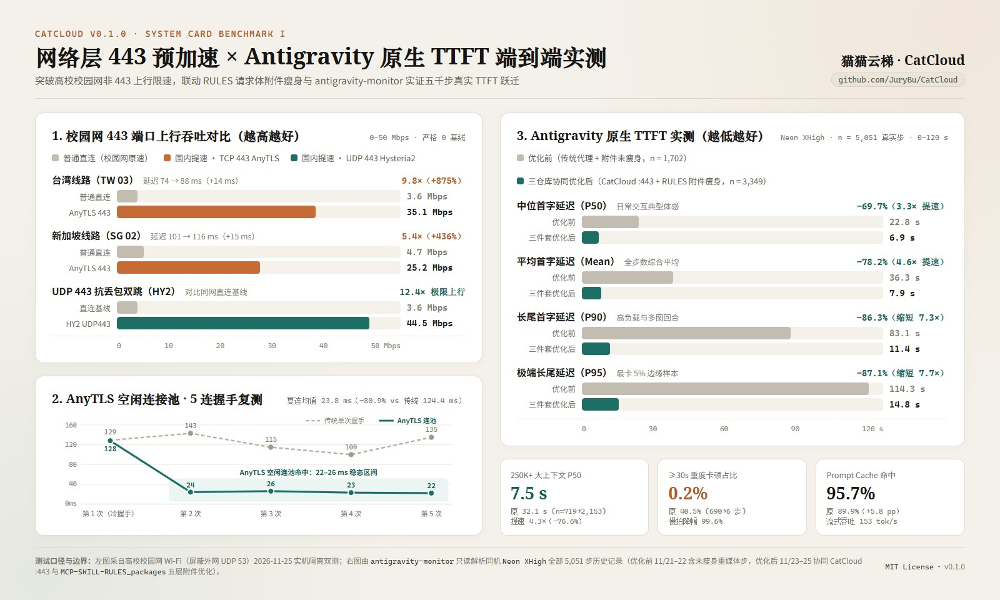
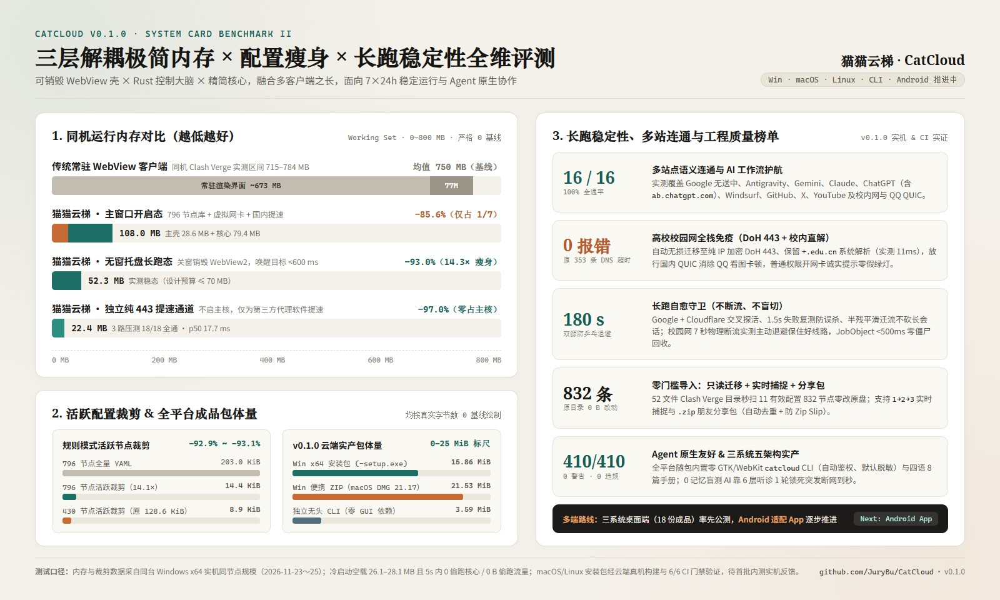
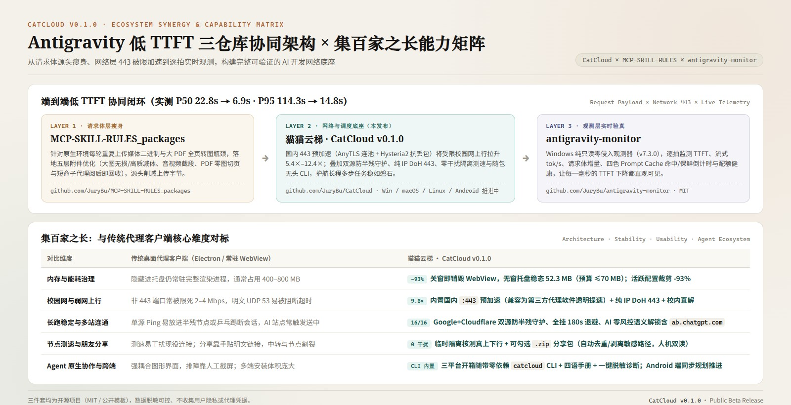

# 发布猫猫云梯（CatCloud）v0.1.0：面向 AI 开发工作流与校园网环境的跨平台智能代理桌面端与无头 CLI

> **快速下载（防点错架构）**：GitHub 底部附件列表按字母排序会把 `arm64` 排在 `x64` 前面，**99% 的普通 Windows（Intel / AMD）电脑请直接点下方 `x64` 链接，不要下 `arm64`**：
> - **Windows 普通电脑（x64）**：[安装版 (.exe, 15.86 MiB)](https://github.com/JuryBu/CatCloud/releases/download/v0.1.0/CatCloud-0.1.0-windows-x64-setup.exe) ｜ [绿色便携版 (.zip, 21.53 MiB，解压即用)](https://github.com/JuryBu/CatCloud/releases/download/v0.1.0/CatCloud-0.1.0-windows-x64-portable.zip) ｜ [MSI 安装包](https://github.com/JuryBu/CatCloud/releases/download/v0.1.0/CatCloud-0.1.0-windows-x64.msi)
> - **macOS**：[Apple Silicon M 系列 (.dmg)](https://github.com/JuryBu/CatCloud/releases/download/v0.1.0/CatCloud-0.1.0-macos-aarch64.dmg) ｜ [Intel Mac (.dmg)](https://github.com/JuryBu/CatCloud/releases/download/v0.1.0/CatCloud-0.1.0-macos-x64.dmg)
> - **Linux（x86_64）**：[AppImage](https://github.com/JuryBu/CatCloud/releases/download/v0.1.0/CatCloud-0.1.0-linux-x86_64.AppImage) ｜ [.deb](https://github.com/JuryBu/CatCloud/releases/download/v0.1.0/CatCloud-0.1.0-linux-x86_64.deb) ｜ [.rpm](https://github.com/JuryBu/CatCloud/releases/download/v0.1.0/CatCloud-0.1.0-linux-x86_64.rpm)
> - *仅骁龙 / ARM 架构 Windows 笔记本选用 `windows-arm64-*`；校验文件见 [SHA256SUMS.txt](https://github.com/JuryBu/CatCloud/releases/download/v0.1.0/SHA256SUMS.txt)。*

今天，我们正式发布 **猫猫云梯（CatCloud）v0.1.0（首批公开内测版）**——一款集国内 `:443` 预加速、低内存三层架构、长程稳定调度与原生 AI Agent 协同能力于一体的跨平台代理桌面端与无头命令行工具（Windows / macOS / Linux）。

在日常上网与高强度 AI 编程工作流中，桌面代理工具长期面临三个彼此牵制的问题：高校校园网与弱网环境对非 443 端口的严苛上行限速（往往限制在 `2–4 Mbps`）会让传图与长上下文请求频频卡顿；基于 Electron 或常驻 WebView 的传统桌面客户端，即便缩进系统托盘也常驻 `400–800 MB` 内存；而在连续多步工具调用与长程任务中，单源 Ping 误切、半残节点反复切换以及目标站点地区误判，随时可能中断正在运行的任务。

**CatCloud v0.1.0 从底层架构重新设计，吸收了主流开源与专用代理客户端的优势，在网络加速、内存治理、长跑稳定性与 Agent 协同四个维度给出完整实测方案。**

---

## 一、网络加速与 TTFT 优化：校园网上行提升 5.4×–12.4×，三仓库协同将原生 TTFT 长尾缩短 7.7 倍

针对高校校园网与弱网环境的上行瓶颈，CatCloud 内置了 **国内 `:443` 预加速引擎**（支持 `AnyTLS` 空闲连接池复用、`Hysteria2` UDP 443 抗丢包、`Trojan` 与 `VLESS`，内建纯 IP 无 SNI 强校验与 `mmrelay://v1/...` 一键导入）。

- **校园网上行实测提升**：在屏蔽外网明文 UDP 53 且限制非 443 端口上行的真实高校校园网 Wi-Fi 下，开启 CatCloud 国内 443 预加速后，台湾线路上行由 `3.6 Mbps` 提升至 **`35.1 Mbps`（`9.8×`）**，新加坡线路由 `4.7 Mbps` 提升至 **`25.2 Mbps`（`5.4×`）**，相应延迟仅增加 `14–15 ms`；启用 UDP 443 Hysteria2 抗丢包双跳后，实测上行达到 **`44.5 Mbps`（`12.4×`）**。
- **AnyTLS 连接池复用降低握手延迟**：通过空闲会话池复用，连续 5 次请求的往返延迟由传统单次握手的均值 `124.4 ms`（`[129, 143, 115, 100, 135] ms`）降至稳态 **`22–26 ms`（复连均值 `23.8 ms`，下降 `80.9%`）**。
- **可为本机其它代理软件透明提速**：即使关闭猫猫云梯的系统代理与虚拟网卡，开启「开启国内提速」仍可通过独立的轻量 `:443` 通道（实测占用 `22.4 MB` 内存，3 路并发外网探活 `18 / 18` 全部通过、`p50 = 17.7 ms`）配合 Windows 官方签名 WinDivert 透明重定向，为本机其它代理软件与 SSH/SCP 解除上行限速，并内置启动实测保护回退与安全软件放行指引。
- **三仓库协同降低 Antigravity 原生 TTFT（首字响应延迟，`n = 5,051` 真实请求步）**：当网络层上行瓶颈被 CatCloud 解除后，与同样开源的 [**MCP-SKILL-RULES_packages**](https://github.com/JuryBu/MCP-SKILL-RULES_packages)（在请求体层对大图、音视频与超大 PDF 做按需减体与分片阅后回收，避免每轮重复回传臃肿媒体二进制）以及 [**antigravity-monitor**](https://github.com/JuryBu/antigravity-monitor)（Windows 纯只读零侵入观测器，按请求步实时追踪 TTFT 首字响应延迟、`tok/s` 与 Prompt Cache 提示词缓存命中状态）协同工作。根据 `antigravity-monitor` 对同机同模型（`Neon XHigh`）全量 **5,051 步** 真实生产对话记录的聚合统计（优化前 11/21–22 共 `n = 1,702` 步含未瘦身重媒体，优化后 11/23–25 共 `n = 3,349` 步协同运行三仓库方案）：
  - **TTFT 中位数（P50）**：`22.8 s → 6.9 s`（下降 **`69.7%`**，提速 **`3.3×`**）
  - **TTFT 长尾（P90 / P95）**：`83.1 s → 11.4 s`（下降 **`86.3%`**）/ `114.3 s → 14.8 s`（下降 **`87.1%`**，缩短 **`7.7×`**）
  - **250K+ 超大上下文 TTFT 中位数**：`32.1 s → 7.5 s`（`n = 719 → 2,153`，提速 **`4.3×`**）
  - **≥ 30 s 重度卡顿步占比**：由 **`40.5%`**（`690 / 1,702` 步）降至 **`0.2%`**（`6 / 3,349` 步）；Prompt Cache（提示词缓存）有效命中率由 `89.9%` 升至 **`95.7%`**，流式生成速度中位数由 `137` 升至 **`153 tok/s`**。

---

## 二、内存治理与性能优化：三层解耦，无窗托盘态较传统客户端降低 93%

CatCloud 采用 **转发引擎（Mihomo） × 纯 Rust 控制大脑（`catcloud-core`） × 可彻底销毁桌面壳（Tauri v2 + React 19）** 的三层解耦设计，将低内存占用与进程确定性回收纳入首版架构基线：

| 评测维度 | 传统常驻 WebView 客户端 / 未裁剪基线 | 猫猫云梯（CatCloud v0.1.0） | 实测变化 |
|---|---|---|---|
| **整机运行内存（主窗开启）** | `750 MB`（同机 Clash Verge 实测 `715–784 MB`） | **`108.0 MB`**（主壳 `28.6 MB` + 核心 `79.4 MB`） | **下降 `85.6%`** |
| **无窗托盘长跑内存** | 隐藏托盘仍常驻 `400–800 MB` 渲染进程 | **`52.3 MB`**（关窗即销毁 WebView，设计预算 `≤ 70 MB`） | **相比 750 MB 基线下降 `93.0%`（`14.3×` 瘦身）** |
| **独立 `:443` 提速通道内存** | 需完整常驻主核心（对比 750 MB 传统基线） | **`22.4 MB`**（0 TUN / 0 DNS 独立轻量通道） | **相比 750 MB 基线下降 `97.0%`** |
| **规则模式配置编译体积** | 796 节点全量 `203.0 KiB` / 430 节点 `128.6 KiB` | **`14.4 KiB`** / **`8.9 KiB`**（按需活跃裁剪） | **下降 `92.9%` / `93.1%`** |
| **成品安装包体积（含核心+CLI）** | Electron 客户端常见 `120–180 MB` | Win 安装包 **`15.86 MiB`** / 便携 ZIP **`21.53 MiB`** / macOS **`21.17 MiB`** | **约 `1/6–1/8` 体量** |
| **冷启动零偷跑实测（静置 5 秒）** | 启动常自动外发测活或拉起核心 | 静置 5 秒驻留内存 **`26.1–28.1 MB`**、`0` 核心偷跑、**`0 B`** 偷跑流量 | **零后台干扰** |

在进程生命周期治理上，CatCloud 通过操作系统原生 `JobObject`（Windows）与 `PR_SET_PDEATHSIG`（Linux）在异常退出后 `< 500 ms` 内回收全部子进程树，避免僵尸内核残留与端口占用；同时通过按需活跃节点裁剪、`geodata-loader: memconservative` 低内存加载与动态堆回收控制核心内存。

---

## 三、集百家之长：长跑稳定性与多站点连通深度优化

CatCloud 融合了主流开源客户端的规则自由度与专用客户端的易用性，集中解决长程稳定运行与多站点访问的实际问题：

- **长跑不掉线、不盲切的双源防半残守护**：摒弃传统单源 Ping 容易选入半残节点或频繁来回切线的做法，采用 Google + Cloudflare 并发双源交叉探活、单次失败 `1.5 s` 即时复测防误判、渐进冷却（`60s → 180s → 600s`）与半惩罚恢复观察机制。半残线路会平滑迁流而不中断正在运行的长会话；实测遭遇校园网 7 秒物理断流时，守护自动识别为外部网络全断并进入 `180 s` 退避拒绝盲切，保住原本稳定的节点。
- **多站点语义连通与校园网全链路适配（实测 `16 / 16` 多站点全通）**：针对封杀外网明文 UDP 53 的校园网，默认并自动无损迁移至纯 IP 加密 DoH 443，同时为 `+.edu.cn` 与局域网保留系统校内解析（实测校内 DNS 解析 `11 ms`，原 353 条校园网 DNS 超时归零）；优先放行国内 QUIC UDP 443 解决 QQ 看图与国内音视频加载卡顿；内置零风控 AI 语义解锁探针（覆盖 Google 真实地区校验防 IP 误判回大陆、Antigravity、Gemini、Claude、ChatGPT 含 `ab.chatgpt.com` 与 Windsurf），并在总览、侧栏、悬浮胶囊与设置四处界面诚实同步虚拟网卡（TUN）真实提权状态，避免普通权限假亮绿灯。
- **零干扰临时隔离测速与便捷迁移分享**：测速时按需拉起仅监听 `127.0.0.1` 的临时隔离核心，支持实时流式出结果、暂停保留已测数据与按住 `Ctrl` 滑动多选，测完即销毁不影响现役连接；导入端支持只读无损迁移主流开源客户端（实测 52 文件目录秒扫 11 份有效配置、832 条节点且原目录 `0 B` 改动）、三步实时捕捉向导，以及兼顾人类与 Agent 阅读的 **`.zip` 分享包（`catcloud-share/v1`）**——可自由勾选节点与国内中转一键打包，自动剥离原订阅链接、控制密钥与本机路径，导入端支持预览与自动指纹去重。

---

## 四、原生 Agent 友好与多端演进路线

CatCloud 将图形界面易用性与 AI Agent 自动化协作作为同等核心设计目标：

- **全平台开箱内置无头 `catcloud` CLI**：无论是 Windows 绿色便携版与安装版、macOS `.dmg` 还是 Linux `.AppImage`/`.deb`/`.rpm`，均随包内置零 GTK/WebKit 依赖的 `catcloud` 命令行工具（独立包仅 `3.45–3.89 MiB`）。CLI 可自动安全识别运行中桌面端的动态控制口令，免配密码直接执行 `net doctor`、`net connections`、`net match`、`logs tail`、`preaccel test --speed` 与 `share import` 等命令，且全部只读输出默认自动脱敏。
- **独立「AI 助手」一级菜单与四语随装手册**：内置简体中文、English、日本語、Русский 四语 8 篇权威指南，区分「发给网页 AI（未翻墙时优先用 DeepSeek / 豆包 / Kimi，亦可发给 ChatGPT / Gemini）」与「发给本机 AI Agent（自动附带随包 CLI 精确路径与手册树）」双入口，并支持一键生成脱敏摘要提交 GitHub Issue。在零记忆盲测中，陌生 AI 仅凭随包 CLI 与分层排障手册，1 轮排查即将突发物理断网精准定位到秒。
- **三仓库生态联动**：
  - 请求体附件优化与多宿主工程规范：[**MCP-SKILL-RULES_packages**](https://github.com/JuryBu/MCP-SKILL-RULES_packages)
  - Windows 原生 TTFT 与 Prompt Cache 实时观测器：[**antigravity-monitor**](https://github.com/JuryBu/antigravity-monitor)
- **当前平台验证范围与 Android 路线图**：
  - **Windows（x64 / ARM64）**：已完成高校校园网、虚拟网卡、底层全局国内提速、分享包与全链路听诊深度实测，推荐下载绿色便携 ZIP（`21.53 MiB`）或安装版（`15.86 MiB`）；
  - **macOS（Apple Silicon / Intel）与 Linux（x86_64）**：全部通过云端真机构建、三系统 `6 / 6` CI 门禁与 `410 / 410` 单元测试，因开发机条件限制暂未做人工桌面端真机操作验证，欢迎首批内测用户反馈体验（macOS 拖入「应用程序」后推荐执行一次 `xattr -dr com.apple.quarantine /Applications/CatCloud.app` 清除隔离属性）；
  - **Android 客户端**：桌面端完成首批内测收敛后，将基于同一套核心配置、`.zip` 分享包与国内 `:443` 预加速协议，逐步推进 **Android 适配 App** 的开发，实现桌面端与移动端无缝共享配置与提速体验。

---

## 五、下载与完整性校验

前往 [GitHub Releases · v0.1.0](https://github.com/JuryBu/CatCloud/releases/tag/v0.1.0) 获取对应平台成品包（全部 18 份多系统安装包均附 `SHA256SUMS.txt` 校验清单与 `latest.json` 自动更新索引，后续发布 `v0.1.1+` 补丁可默认在下次启动自动无缝升级）。若国内直连 GitHub 下载较慢，可请朋友直接转传对应平台包并核对 `SHA256SUMS.txt`。
